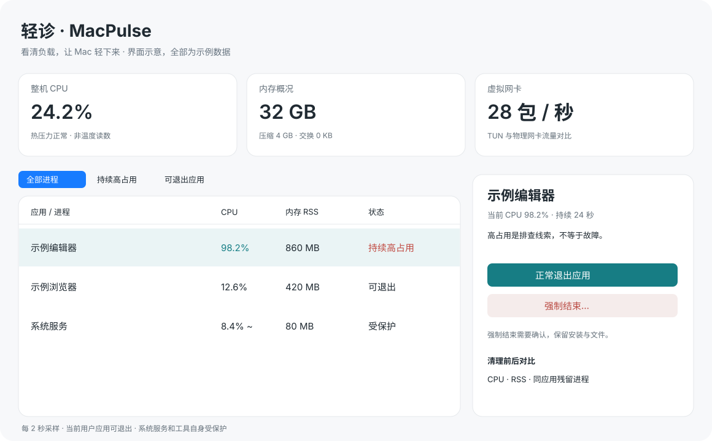

# 轻诊 1.4.0 · Mac 工具盒

使用与[人生计时器](https://github.com/1eader0ne/life-timer)相同的 **Swift + AppKit** 原生技术栈，通过 `swiftc` 构建。另有少量 C 代码连接 macOS 系统采样接口；无 Electron、后台服务器或外部依赖。

适用于 Apple Silicon Mac，最低 macOS 12。构建使用本机 ad hoc 签名，未使用 Developer ID 或进行 Apple 公证。开发版更新后系统可能重新询问文件夹授权；若同一版本重复询问，可先使用“指定文件夹”明确指定扫描目录。跨版本持久授权需后续使用稳定的开发者签名，本版不会通过重置权限或放宽签名要求来规避。全盘扫描如需更完整覆盖，由你自行在系统设置中为轻诊授予“完全磁盘访问权限”，工具不会自动授予。



## 使用

源码构建后双击 `轻诊.app` 即可运行；也可使用 `package.sh` 生成 `轻诊-1.4.0.dmg`，将应用拖入 Applications。顶部切换“运行诊断 / 磁盘空间 / 重复文件 / 网络健康 / 应用卸载”。关闭最后一个窗口会退出工具并停止采样。

### 应用卸载与残留检查（1.4 新增）

顶部“应用卸载”提供两个模式。应用清单读取 /Applications 与当前用户 Applications 中的标准应用包（有限深度，不进入应用内部搜集辅助程序）；支持按名称 / 标识搜索，或明确选择这些目录中的应用。点击“检查关联文件”才统计应用与关联路径，默认不勾选任何项目。可“只选应用本体”保留个人设置，也可逐项核对后选择可处理项目。

关联检查按完整 bundle identifier 精确匹配当前用户 Library 下的 Caches、Preferences、Logs、Saved Application State、HTTPStorages、WebKit、Application Support。Application Support 明确标为“应用数据（需备份）”，可能含数据库、配置和登录状态。只有名称相似的 Application Support 目录、沙盒 Containers 与 LaunchAgents 后台服务仅查看；共享 Group Containers、钥匙串、系统扩展、安装收据及其他用户目录不处理，不使用模糊前缀匹配批量清理。

“疑似残留”从上述常用目录发现应用标识，再与常用应用目录和系统应用登记核对；没有找到应用仍不代表数据无用，可能存在其他副本或未登记应用。候选需要用户确认对应应用已卸载、数据不再需要后才能移入废纸篓。应用清单读取不完整时，残留候选只供查看；发现对应应用重新安装或仍在运行时拒绝移动。

系统 / Apple 应用、轻诊自身、运行中的应用及其关联文件受到保护。另一份相同标识的应用仍存在时，只允许处理所选应用本体，保留可能共用的设置。链接应用不支持卸载；精确路径指向链接、统计不完整或存在受保护 / 云端占位内容时只供查看。

扫描只读取文件元数据，用完整路径、设备 / inode、权限 / 所属、大小、修改时间等计算文件树指纹，不读取关联文件正文。单项最多约 100,000 个目录项 / 30 秒，达到上限或无权限会标为未完整统计，不允许直接移动该目录；支持取消检查。移动前再次检查应用身份、运行状态、其他安装副本和整个文件树。文件变化时跳过；先处理所选关联项、最后处理应用本体，逐项报告结果。每次最多处理 20 项，仅调用系统废纸篓，不提权、不永久删除、不自动清空。处理后必须重新检查，旧证据不能重复使用。

软件如果包含官方卸载器，应优先使用官方程序，以处理登录项、后台服务、扩展和自定义组件。仅将应用本体移入废纸篓不保证彻底卸载。卸载页提供 Apple 官方说明和 Finder 定位入口；权限不足时反馈错误，不自动修改隐私设置。可在 Finder 废纸篓中放回项目，清空前请确认使用正常。切换工具页保留当前结果和勾选。

### 重复文件（1.3 新增）

顶部进入“重复文件”，选择当前用户的个人文件夹后开始查找：先按大小筛选，只对大小重复的非空普通文件流式计算 SHA-256，再逐字节比较，文件名不同也能识别。读取仅用于本机核对，不上传。标签、权限等元数据不参与相同内容判定；带资源叉的文件会排除，避免忽略独立内容。跳过隐藏路径、应用 / 照片库等文件包、链接、硬链接、跨设备目录、云端占位、压缩及不可变文件，不扫描系统或当前用户 Library。

每组按路径排序固定保留第一份，默认不选中任何副本；“选择多余副本”一次最多选 1,000 项，也可逐项勾选。在 Finder 中确认用途后，明确确认才会移入系统废纸篓，不永久删除，不自动清空。清理前再次验证保留文件与所选副本的身份、内容和目录，保留文件变化 / 消失时拒绝操作。相同内容不代表副本没有用途；请先关闭正在编辑这些文件的应用。操作后要求重新查找，避免用旧分组再次清理。

后台查找可取消，单次最多检查 50,000 项、约 120 秒、累计读取 20 GiB（含校验与比较），达到上限或权限受限会标明部分结果。文件很多或很大时可缩小文件夹范围。移入废纸篓的重新校验另有同样的时间 / 读取预算。估算副本占用不是实际可释放空间，APFS 克隆和快照会影响结果。切换工具页保留查找状态与选择，后台查找继续执行。

### 网络健康（1.3 新增）

顶部进入“网络健康”，仅点击“开始检查”时执行一次检查，默认目标为 www.apple.com，提供百度预设和自定义域名。检查本地系统网络路径、全局 DNS 配置、全局代理、系统解析器实际域名解析，以及目标的 HTTPS HEAD 响应。系统路径读取约 2 秒、DNS 查询约 3 秒、HTTPS 总等待约 8 秒上限；支持取消，DNS 阶段最多等待本次查询结束。不会上传本地文件或进程信息，不做测速下载，不修改 DNS、代理、VPN、路由、Wi-Fi 或权限。

HTTPS 使用正常的系统证书验证，不绕过 TLS 错误，不附带存储的 Cookie 或账号凭据，不跟随重定向。2xx 作为本次请求成功，重定向 / 403 / 5xx 说明已收到服务器响应，显示需留意；解析失败、超时、离线、TLS 错误分别提供建议。一个目标不代表整个互联网，可更换域名复测；显示的耗时包含解析、代理和握手，不是网速。系统配置可能由接口、VPN 或加密 DNS 管理，全局未列出地址 / 代理不表示不存在。不会因为启用代理就认定异常。

结果是一次快照，切换页签继续保留；可显式复制检查报告，报告含目标和本机配置，分享前请核对。没有后台轮询或自动修复。

“网络健康”内切换到 **“网络抓包”**，选择网卡后点击“授权并开始抓包”。使用 macOS 自带的 tcpdump，通过系统管理员授权打开抓包设备，随后降回当前用户写入文件；不安装常驻提权服务，不改变设备权限或网络配置。可选择 en 网卡、lo0 本机回环或 utun VPN 接口；使用非混杂模式，不开启无线监听模式。一次只抓所选接口，VPN / 代理流量可能需要换接口观察。

支持 TCP、UDP、DNS、HTTPS（含 UDP 443）、ICMP 预设及自定义 BPF 条件，例如 `host 192.168.1.1 and tcp port 443`。实时列表展示时间、协议、来源 / 目标地址与端口、原始长度和摘要，选中查看十六进制数据。默认最多 30 秒、5,000 包、每包前 256 字节；可改为 15 / 60 / 120 秒或每包前 1518 字节，文件最多约 8 MB。达到包数 / 时限、点击停止或退出应用后结束；即使没有匹配流量也会按时停止。切换子页和工具页继续抓取并保留结果。授权取消、无效过滤条件或接口错误会显示失败原因。

结束后可导出标准 `.pcap` 文件，用 Wireshark 或 tcpdump 深入分析。截取长度不足时正文可能不完整，HTTPS / TLS 内容保持加密，不安装证书或解密代理。数据包可能含域名、IP 和明文内容；记录只写入当前用户专用的临时目录，清空、开始新一轮抓包或正常退出时删除旧记录，不上传。应用启动及每次抓包前，在后台清理异常退出遗留的临时记录：当前会话持有文件锁，其他实例正在抓包或保留的查看结果会跳过；进程崩溃后锁由系统释放，下次检查即可清理。旧版无锁记录至少保留 24 小时，并核对目录及所有文件的最新修改时间。只处理本工具固定格式的临时目录和已知普通文件，不跟随链接，目录中有其他文件时跳过；清理失败会保留并重试。手动导出的文件由用户管理。分享前请核对内容。

### 磁盘空间（1.1 新增）

“旧缓存 / 旧日志 / 大文件”各自保留本次应用会话中的扫描结果、勾选、明细、滚动位置和扫描报告，切换页签不重新扫描。重新扫描只更新当前范围；全盘和指定文件夹分别保留结果，重选文件夹只清除旧的指定文件夹结果。退出应用后不保留这些记录，清理前仍会重新校验文件身份。

- 显示当前用户所在磁盘的总容量和系统报告可用空间；此值可能与系统设置中的可清除空间口径不同。
- “旧缓存”只扫描 `~/Library/Caches` 中至少 7 天未修改的普通文件；“旧日志”只扫描 `~/Library/Logs` 中至少 30 天未修改的普通文件。
- **“大文件”默认扫描本机启动磁盘**，点击右侧“开始全盘扫描”即可查找至少 100 MiB 的普通文件，涵盖当前允许访问的用户目录、应用内部、Library 和系统目录。扫描系统卷与 Data 卷的正常路径，排除 `/System/Volumes` 的重复 / 辅助卷入口、`/Volumes` 下的外置与网络盘、虚拟设备及其他挂载设备。不会跟随符号链接，不下载云端占位文件；硬链接按文件身份去重。受系统权限限制，不能保证读取每个位置，界面和报告会说明未覆盖范围。
- 保留“指定文件夹”按钮：通过系统选择器选择个人文件夹（默认建议 Downloads）后扫描；同一次运行保留该目录访问。“切换到全盘”只切换范围并恢复全盘结果；“已选：全盘”表示当前范围，点击右侧“开始全盘扫描”才启动扫描。**大文件不代表无用文件**，请先在 Finder 中核实用途。
- 若误点系统权限弹窗的“不允许”，扫描会显示权限受限并提供恢复入口。个人文件夹可在“系统设置 → 隐私与安全性 → 文件与文件夹 → 轻诊”开启访问，返回重试；全盘如需覆盖更多受限位置，可在“完全磁盘访问权限”自行添加 / 开启轻诊，按系统提示重启后重试。部分系统位置仍可能受限。本工具不自动更改或重置权限。也可通过系统选择器重选有访问权限的个人文件夹。
- 扫描在后台执行，可取消。全盘扫描会持续遍历至结束或用户取消，不因原来 25 秒 / 50,000 项的上限提前结束；文件较多时可能耗时较长。为控制列表内存，最多展示占用最大的 10,000 个文件，超出后仍继续遍历，报告列出总匹配数。指定文件夹 / 缓存 / 日志保持 25 秒、50,000 项、10,000 个结果上限。优先遍历当前用户目录，结果按估算磁盘占用排序。取消、截断或权限受限会明确显示部分结果；完成时显示“可访问范围扫描完成”。只读取元数据，不下载或读取文件内容，单次系统文件访问期间需等待返回才能取消。
- 展示完整路径、文件大小、估算磁盘占用和修改时间。**默认不选择任何文件**；逐项选择，或点击表头“全选”/底部“全选结果”，一次选中本次扫描中所有可清理的结果；“仅查看”项不会被选中。部分选中显示半选状态，再点表头补齐全选；全选后再次点击取消全选。确认后移入系统废纸篓，超过 1,000 项会在后台自动分批执行。
- 全盘模式的系统、其他用户、Library、隐藏路径、应用 / 照片库等文件包内部、硬链接、压缩和不可变文件可以查看，但显示“仅查看”，不能勾选；只有当前用户普通个人子文件夹里、满足保护校验的文件可清理。扫描范围扩大不会扩大清理权限。
- 指定文件夹 / 缓存 / 日志扫描继续跳过链接、硬链接、隐藏目录、文件包、跨设备目录、云端占位、压缩和不可变文件。缓存 / 日志会跳过按 bundle ID 识别的运行中应用目录；未知命名目录无法可靠关联应用，请先退出相关应用再操作。Library 清理仍仅限两个专用入口，不申请管理员权限。操作前重新核对文件身份、修改时间、归属和目录范围，发生变化即跳过。移动失败会保留源文件，不转用永久删除。
- **移入废纸篓不会立即释放空间**。本工具只报告移动了多少文件及其估算占用，提供“打开废纸篓”，不自动清空。可在 Finder 中放回原处，或自行确认后清空。APFS 克隆、快照和稀疏文件可能使实际释放量与估算不同；缓存也可能重新生成。

### 运行诊断

1. 每两秒采样一次 CPU、内存 RSS、内存压缩与交换、系统热压力以及虚拟网卡包速率。
2. 列表将一个应用及其辅助进程合并显示，按 CPU 降序排列；可搜索应用、进程名或 PID。
3. 默认 CPU 超过单核 80% 且持续 15 秒才标出“持续高占用”。阈值可选 30%、50%、80%、100%、150%。高占用是排查线索，不等于程序故障。
4. 点击应用查看明细。优先选择“正常退出应用”；应用可自行提示保存或拒绝退出。需要时另行点击“强制结束”，明确确认后执行。
5. 清理后重新采样，展示 CPU、RSS 变化和同应用残留进程数；应用自动重启时会说明尚有进程。
6. 可以暂停监测或导出本机 JSON 诊断报告。报告可能包含应用名、进程号和本机路径，请自行判断分享范围。

## 读数与保护边界

- **整机 CPU**：所有核心合计按 0–100% 显示。**应用 CPU**：100% 代表一个逻辑核心，多个核心可能超过 100%。
- 原生采样使用两个时刻的累计 CPU 时间差，包含 Apple Silicon 时间单位转换。受限的系统进程由系统 `/bin/ps` 提供只读平滑读数，以 `~` 标记，不能当成两秒瞬时值。
- RSS 为各进程驻留内存之和，共享页可能重复计算；它与活动监视器的“内存”口径不同。内存大不单独判定故障，不会通过占用内存再释放的方式“清内存”。
- 热压力由系统提供，**不是 CPU 温度**。本版不读取私有温度传感器，也不控制风扇。
- 网卡首次采样、计数重置或接口刚出现时等待下一次采样。TUN 包速率远高于物理网卡时只报告可疑失衡，不宣称已经证明网络循环。
- CPU、系统服务读数与真实负载可能瞬时变化，诊断不自动指认某个应用导致硬件发热。
- 只允许退出当前用户、已注册的非 Apple 应用。保护系统服务、其他用户、工具自身、命令行进程和身份不完整的进程。
- 每次清理前核对 PID、启动时间、用户、可执行路径、应用路径和 bundle ID。进程退出或 PID 被重用时拒绝对新进程操作。
- 运行诊断不自动结束应用、不卸载软件、不删除文件、不更改代理或 DNS，不索取管理员权限。磁盘工具仅在明确选择并确认后移入废纸篓；记录仅保存在当前会话内。
- 强制结束可能丢失未保存内容。正常退出超时后不会自动强制结束。

## 从源码构建

需要 Xcode Command Line Tools（本机已安装）。

```bash
cd native-app
bash build.sh
bash test.sh
bash package.sh
../轻诊.app/Contents/MacOS/MacPulse --probe
```

构建产物为上一层的 `轻诊.app`，中间文件默认写入 `.build`；可用环境变量 `MACPULSE_BUILD_DIR` 指定其他位置，用 `MACPULSE_APP_DIR` 指定测试应用输出目录，并将同一变量传给 `test.sh` 和 `package.sh`，避免重编译覆盖正在使用的应用。测试仅创建和结束专门的 Fixture 应用及一个测试 CPU 进程，不会结束用户现有应用。全盘测试使用自建的模拟启动磁盘，覆盖系统 / 应用 / 用户文件、重复入口与硬链接去重、只读保护、显示数量上限、权限拒绝、取消及扫描模式缓存，不遍历整台机器。磁盘测试只使用随机命名的自建目录及样本，实际移入废纸篓的一个测试文件会恢复后清理，不操作用户既有文件。界面集成测试覆盖模块切换、异步扫描、默认未选择、选择清空、访问错误和取消恢复。

源码：`MonitorBridge.c/.h`（系统接口）、`Monitor.swift`（采样、聚合、判定与进程身份）、`Interface.swift`（工具盒与诊断界面）、`DiskCleaner.swift`（扫描与文件保护）、`DiskInterface.swift`（磁盘界面）、`DiskTests.swift`（磁盘及界面测试）、`main.swift`（入口及诊断测试）、`Icon.swift`（原生矢量图标绘制）、`DuplicateFinder.swift`（重复内容与保留项保护）、`NetworkHealth.swift`（连接 / DNS / HTTPS）、`ToolInterfaces.swift`（两个新工具界面）、`ToolTests.swift`（工具样本测试）、`AppUninstaller.swift`（应用与关联数据的范围、身份及文件树保护）、`UninstallInterface.swift`（卸载界面）、`UninstallTests.swift`（卸载与残留测试）。`package.sh` 生成并校验 DMG；它只删除自己创建的临时打包目录。

相关接口依据：[Apple NSRunningApplication.forceTerminate](https://developer.apple.com/documentation/appkit/nsrunningapplication/forceterminate())、[Apple XNU proc_info.h](https://github.com/apple-oss-distributions/xnu/blob/main/bsd/sys/proc_info.h)、[Apple FileManager.trashItem](https://developer.apple.com/documentation/foundation/filemanager/trashitem(at:resultingitemurl:))、[Apple 释放磁盘空间说明](https://support.apple.com/en-au/102624)。
